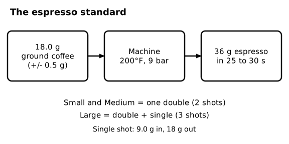
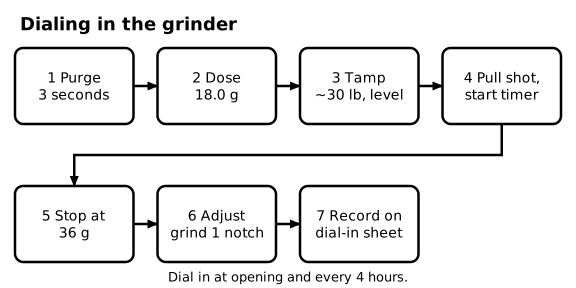
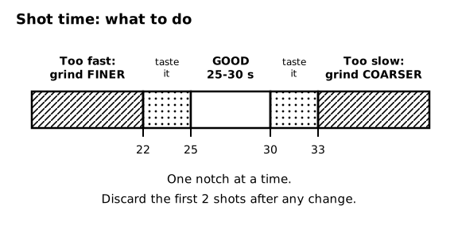
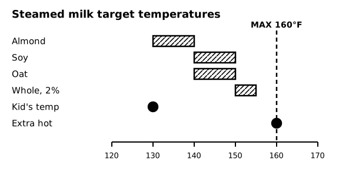
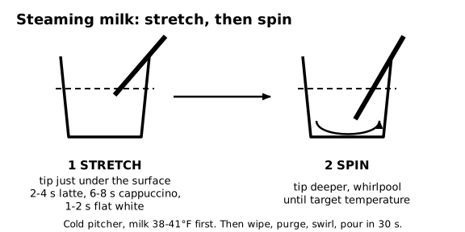
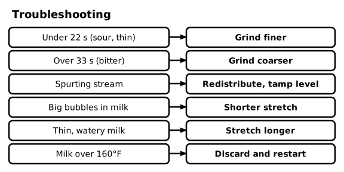

# SOP-220 Espresso Bar - Shot and Milk Standards

Ember & Oak Coffee is a fictional company. This is a sample document for software testing only.

## 1 Purpose and Scope

### 1.1 Purpose
This SOP sets the standard for espresso shots and steamed milk so every drink tastes the same.

## 2 Espresso Standard

### 2.1 Recipe specifications
| Setting | Standard |
|---|---|
| Dose (ground coffee, double basket) | 18.0 g, plus or minus 0.5 g |
| Yield (liquid espresso) | 36 g |
| Shot time | 25 to 30 seconds |
| Brew water temperature | 200°F (93°C) |
| Brew pressure | 9 bar |

A single shot uses a 9.0 g dose and an 18 g yield.

### 2.2 Shots by size
Small and Medium drinks use one double (2 shots). Large drinks use one double plus one single (3 shots). An extra shot adds one single.

### 2.3 Freshness
Serve espresso within 30 seconds of pulling it. Discard older shots.

### 2.4 Diagram - The espresso standard

Figure 2.4 shows: Espresso standard: 18.0 g of ground coffee (plus or minus 0.5 g) at 200°F and 9 bar gives 36 g of espresso in 25 to 30 seconds. Small and Medium use a double (2 shots). Large uses a double plus a single (3 shots). A single is 9.0 g in and 18 g out.

## 3 Dialing In the Grinder

### 3.1 Purge
<!-- step -->
Run the group head for 3 seconds to flush it.

### 3.2 Dose
<!-- step -->
Grind into the portafilter and weigh 18.0 g on the scale. Adjust the grind amount if the dose is outside 17.5 to 18.5 g.

### 3.3 Tamp
<!-- step -->
Level the grounds and tamp with firm, even pressure (about 30 lb or 13.5 kg).

### 3.4 Pull the shot
<!-- step -->
Lock in the portafilter and start the shot and the timer together.

### 3.5 Stop at yield
<!-- step -->
Stop the shot at 36 g of liquid on the scale. It should take 25 to 30 seconds.

### 3.6 Adjust the grind
<!-- step -->
If the shot takes under 22 seconds, grind finer. If it takes over 33 seconds, grind coarser. If it takes 22 to 25 or 30 to 33 seconds, taste it and decide. Change the grind one notch at a time, and discard the first two shots after any change.

### 3.7 Record it
<!-- step -->
Write the grind setting, dose, yield, time, time of day, and your initials on the dial-in sheet. Dial in at opening and again every 4 hours.

### 3.8 Diagram - Dialing in the grinder

Figure 3.8 shows: Dial-in steps: 1 purge 3 seconds, 2 dose 18.0 g, 3 tamp about 30 lb and level, 4 pull the shot and start the timer, 5 stop at 36 g, 6 adjust the grind one notch, 7 record on the dial-in sheet. Dial in at opening and every 4 hours.

### 3.9 Diagram - Shot time: what to do

Figure 3.9 shows: Shot time scale: under 22 seconds, grind finer. 22 to 25 seconds, taste it. 25 to 30 seconds is good. 30 to 33 seconds, taste it. Over 33 seconds, grind coarser. Change one notch at a time and discard the first 2 shots after any change.

## 4 Steaming Milk

### 4.1 Target temperatures
| Milk | Target temperature |
|---|---|
| Whole and 2 percent | 150 to 155°F (65 to 68°C) |
| Soy | 140 to 150°F (60 to 65°C) |
| Oat | 140 to 150°F (60 to 65°C) |
| Almond | 130 to 140°F (54 to 60°C) |

Never exceed 160°F (71°C). If milk goes above 160°F, discard it and start over.

### 4.2 Special temperature requests
"Extra hot" is 160°F (71°C), which is the maximum. "Kid's temp" is 130°F (54°C).

### 4.3 Foam depth
Latte: about 1/4 inch (6 mm) of microfoam. Cappuccino: about 3/4 inch (2 cm) of foam. Flat white: about 1/8 inch (3 mm) of thin microfoam.

### 4.4 Purge the wand
<!-- step -->
Purge the steam wand for 2 seconds before and after every use.

### 4.5 Start cold
<!-- step -->
Pour the milk amount from the recipe (SOP-230) into a cold pitcher. Milk should be 38 to 41°F. Use the 12 oz pitcher for Small drinks and the 20 oz pitcher for Medium and Large.

### 4.6 Stretch
<!-- step -->
Place the tip just under the surface and add air: 2 to 4 seconds for a latte, 6 to 8 seconds for a cappuccino, 1 to 2 seconds for a flat white.

### 4.7 Spin
<!-- step -->
Submerge the tip deeper to spin a whirlpool until the milk reaches its target temperature, which is when the pitcher is too hot to hold for more than 2 to 3 seconds.

### 4.8 Finish
<!-- step -->
Turn off the steam, wipe the wand with a sanitized cloth, and purge it. Tap the pitcher and swirl to remove bubbles. Pour within 30 seconds.

### 4.9 Leftovers and allergy orders
Never re-steam milk. Discard leftovers. For allergy-flagged orders, use a clean pitcher and a freshly sanitized wand.

### 4.10 Diagram - Steamed milk target temperatures

Figure 4.10 shows: Milk temperatures: almond 130 to 140°F, soy 140 to 150°F, oat 140 to 150°F, whole and 2 percent 150 to 155°F, kid's temp 130°F, extra hot 160°F. Never exceed 160°F.

### 4.11 Diagram - Steaming milk: stretch, then spin

Figure 4.11 shows: Steaming: stretch with the tip just under the surface (2 to 4 seconds latte, 6 to 8 seconds cappuccino, 1 to 2 seconds flat white), then spin with the tip deeper until the milk reaches its target temperature. Start with cold milk at 38 to 41°F, then wipe, purge, swirl, and pour within 30 seconds.

## 5 Troubleshooting

### 5.1 Troubleshooting table
| Problem | Likely cause | Fix |
|---|---|---|
| Sour or thin shot, under 22 seconds | Grind too coarse | Grind finer |
| Bitter or burnt shot, over 33 seconds | Grind too fine | Grind coarser |
| Spurting or uneven stream | Channeling from an uneven tamp | Redistribute the grounds and tamp level |
| Large bubbles in milk | Too much air, or air added too long | Shorten the stretch time |
| Thin, watery milk | Too little air | Stretch longer |
| Scalded or flat milk | Over 160°F | Discard and restart |

### 5.2 Diagram - Troubleshooting

Figure 5.2 shows: Troubleshooting: under 22 seconds, grind finer. Over 33 seconds, grind coarser. Spurting stream, redistribute and tamp level. Big bubbles, shorten the stretch. Thin milk, stretch longer. Milk over 160°F, discard and restart.

## 6 Machine Alerts

### 6.1 Pressure ranges
Brew pressure should read 9 bar (8 to 10 bar is acceptable). Steam boiler pressure should read 1.0 to 1.5 bar. Tell the shift lead if either is outside its range.

### 6.2 Low water or leaks
If the low-water light comes on, stop making espresso and tell the shift lead. Do not run the machine empty. If a group head leaks, stop using it and tell the shift lead.
