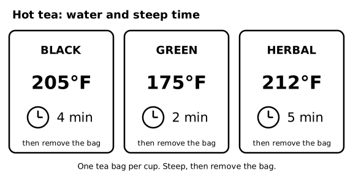
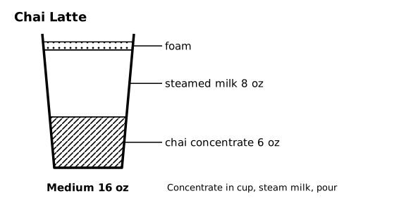
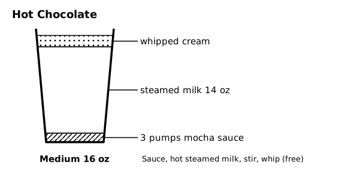
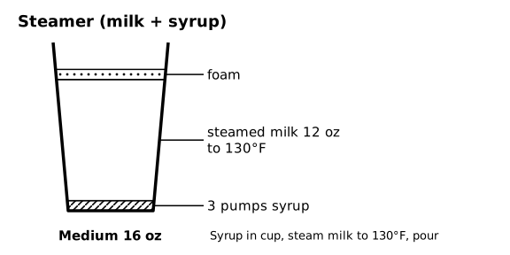
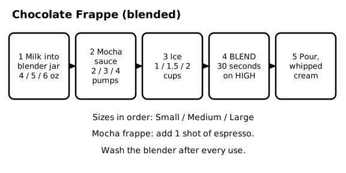

# SOP-231 Tea, Chai, Hot Chocolate, Steamers, and Blended Drinks

Ember & Oak Coffee is a fictional company. This is a sample document for software testing only.

## 1 General Rules

### 1.1 Scope and sizes
This SOP covers the non-espresso hot drinks and the blended drinks. Espresso drinks are in SOP-230. Sizes are the same as everywhere: Small is 12 oz, Medium is 16 oz, and Large is 20 oz.

### 1.2 Prices
| Drink | Small | Medium | Large |
|---|---|---|---|
| Hot Tea | $2.75 | $3.25 | $3.75 |
| Chai Latte | $4.95 | $5.70 | $6.45 |
| Hot Chocolate | $4.50 | $5.25 | $6.00 |
| Steamer | $3.95 | $4.50 | $5.00 |
| Chocolate Frappe | $5.75 | $6.50 | $7.25 |

Modifier charges are in SOP-201. Whipped cream is free.

## 2 Hot Tea

### 2.1 Tea specifications
| Tea | Water temperature | Steep time |
|---|---|---|
| Black | 205°F (96°C) | 4 minutes |
| Green | 175°F (80°C) | 2 minutes |
| Herbal | 212°F (100°C) | 5 minutes |

Use one tea bag per cup in every size. Fill the cup to the fill line with water at the temperature above.

### 2.2 Tea: set up the cup
<!-- step -->
Put one tea bag in the cup and pour in the hot water at the right temperature for that tea.

### 2.3 Tea: steep
<!-- step -->
Start the timer for the steep time in section 2.1. Do not leave the bag in longer, or the tea turns bitter.

### 2.4 Tea: remove the bag
<!-- step -->
Take out the tea bag when the timer ends, put it in the trash, add the lid, and call the name. Offer honey or lemon from the condiment bar.

### 2.5 Diagram - Hot tea: water and steep time

Figure 2.5 shows: Tea: black tea 205°F for 4 minutes, green tea 175°F for 2 minutes, herbal tea 212°F for 5 minutes. One tea bag per cup, then remove the bag.

## 3 Chai Latte

### 3.1 Chai specifications
| | Small | Medium | Large |
|---|---|---|---|
| Chai concentrate | 4 oz | 6 oz | 8 oz |
| Steamed milk | 6 oz | 8 oz | 10 oz |

Foam is about 1/4 inch. Chai concentrate is kept at 41°F or below and is good for 14 days after opening.

### 3.2 Chai: add concentrate
<!-- step -->
Pour the chai concentrate into the empty cup.

### 3.3 Chai: steam the milk
<!-- step -->
Steam the milk to its target temperature (see SOP-220), stretching for 2 to 4 seconds.

### 3.4 Chai: pour
<!-- step -->
Pour the milk into the concentrate, add the lid, and call the name.

### 3.5 Dirty chai
A dirty chai is a chai latte with espresso. Add one shot of espresso, charged as an extra shot ($1.00). Pull the shot into the cup before adding the concentrate.

### 3.6 Diagram - Chai Latte

Figure 3.6 shows: Medium chai latte: 6 oz of chai concentrate and 8 oz of steamed milk with a little foam.

## 4 Hot Chocolate

### 4.1 Hot chocolate specifications
| | Small | Medium | Large |
|---|---|---|---|
| Mocha sauce | 2 pumps | 3 pumps | 4 pumps |
| Steamed milk | 10 oz | 14 oz | 16 oz |

One pump of mocha sauce is 1/2 fl oz. Whipped cream is optional and free.

### 4.2 Hot chocolate: add sauce
<!-- step -->
Pump the mocha sauce into the empty cup.

### 4.3 Hot chocolate: steam and pour
<!-- step -->
Steam the milk to its target temperature, pour it over the sauce, and stir until the sauce is dissolved.

### 4.4 Hot chocolate: top
<!-- step -->
Top with whipped cream if the guest wants it, add the lid, and call the name.

### 4.5 Kid's hot chocolate
For a kid's hot chocolate, steam the milk to 130°F (54°C). Never serve a kid's drink hotter than 130°F.

### 4.6 Diagram - Hot Chocolate

Figure 4.6 shows: Medium hot chocolate: 3 pumps of mocha sauce and 14 oz of steamed milk, with optional whipped cream.

## 5 Steamer

### 5.1 Steamer specifications
| | Small | Medium | Large |
|---|---|---|---|
| Flavor syrup | 2 pumps | 3 pumps | 4 pumps |
| Steamed milk | 8 oz | 12 oz | 16 oz |

A steamer is steamed milk with flavor syrup and no espresso. Steam it to kid's temp, 130°F (54°C), unless the guest asks for extra hot (160°F).

### 5.2 Steamer: add syrup
<!-- step -->
Pump the syrup (vanilla, caramel, or hazelnut) into the empty cup.

### 5.3 Steamer: steam and pour
<!-- step -->
Steam the milk to 130°F, pour it in, stir, add the lid, and call the name.

### 5.4 Diagram - Steamer (milk + syrup)

Figure 5.4 shows: Medium steamer: 3 pumps of syrup and 12 oz of milk steamed to 130°F.

## 6 Chocolate Frappe (Blended)

### 6.1 Frappe specifications
| | Small | Medium | Large |
|---|---|---|---|
| Milk | 4 oz | 5 oz | 6 oz |
| Mocha sauce | 2 pumps | 3 pumps | 4 pumps |
| Ice | 1 cup | 1.5 cups | 2 cups |

Blend for 30 seconds on high. Whipped cream is optional and free. A mocha frappe adds one shot of espresso, charged as an extra shot.

### 6.2 Frappe: add liquids
<!-- step -->
Pour the milk into the blender jar, then pump in the mocha sauce.

### 6.3 Frappe: add ice
<!-- step -->
Add the ice, measured with the ice scoop, never with a cup.

### 6.4 Frappe: blend
<!-- step -->
Lock the lid, then blend for 30 seconds on high until smooth.

### 6.5 Frappe: serve
<!-- step -->
Pour into a cold cup, top with whipped cream if the guest wants it, add a dome lid and a straw, and call the name. Wash the blender right away (see SOP-270).

### 6.6 Diagram - Chocolate Frappe (blended)

Figure 6.6 shows: Chocolate frappe: milk 4, 5, 6 oz, mocha sauce 2, 3, 4 pumps, and ice 1, 1.5, 2 cups for Small, Medium, Large. Blend 30 seconds on high. A mocha frappe adds one shot of espresso.
