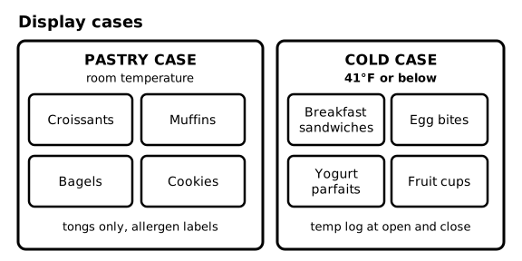
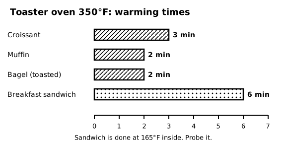
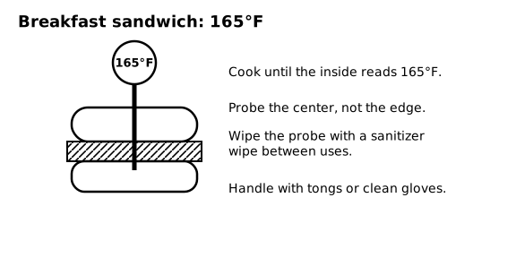
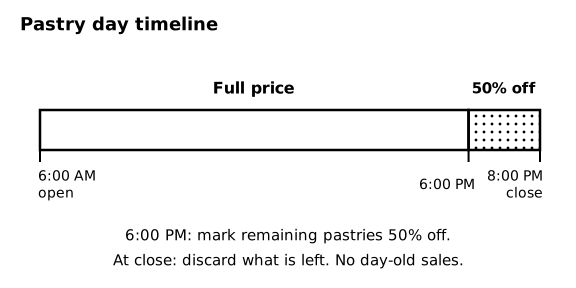

# SOP-240 Food Case, Warming, and Pastry Service

Ember & Oak Coffee is a fictional company. This is a sample document for software testing only.

## 1 Purpose and Scope

### 1.1 Purpose
This SOP covers the pastry case, the cold case, warming and toasting food, and what to do with food at the end of the day. Receiving deliveries is in SOP-280. Hand hygiene and shelf life rules are in SOP-210.

## 2 Menu and Cases

### 2.1 Food prices
| Item | Price |
|---|---|
| Croissant | $3.75 |
| Muffin | $3.50 |
| Bagel | $3.25 |
| Cookie | $2.75 |
| Breakfast sandwich | $6.95 |
| Egg bites | $5.50 |
| Yogurt parfait | $4.95 |
| Fruit cup | $4.25 |

Cream cheese on a bagel is $0.75 extra.

### 2.2 The two cases
The pastry case holds croissants, muffins, bagels, and cookies at room temperature. The cold case holds breakfast sandwiches, egg bites, yogurt parfaits, and fruit cups at 41°F (5°C) or below. Read the cold case thermometer when you open and when you close, and write the reading on the temperature log.

### 2.3 Diagram - Display cases

Figure 2.3 shows: The pastry case holds croissants, muffins, bagels, and cookies at room temperature. The cold case holds breakfast sandwiches, egg bites, yogurt parfaits, and fruit cups at 41°F or below. Log the cold case temperature at open and close.

## 3 Setting Up the Case

### 3.1 Wash hands
<!-- step -->
Wash your hands for 20 seconds before touching any food.

### 3.2 Arrange the items
<!-- step -->
Put each item in its own labeled spot. Put new stock behind old stock (first in, first out).

### 3.3 Label allergens
<!-- step -->
Make sure every item has its card showing the allergens it contains. Pastries contain wheat, milk, and eggs, and some contain tree nuts.

### 3.4 Set out tongs
<!-- step -->
Place a clean pair of tongs in each case. Never touch food with bare hands.

## 4 Warming and Toasting

### 4.1 Warming times
The toaster oven is set to 350°F (177°C).
| Item | Time |
|---|---|
| Croissant | 3 minutes |
| Muffin | 2 minutes |
| Bagel (toasted) | 2 minutes |
| Breakfast sandwich | 6 minutes |

### 4.2 Warm the item
<!-- step -->
Pick up the item with tongs, place it on the oven tray, and set the timer from the table in section 4.1.

### 4.3 Check the sandwich temperature
<!-- step -->
A breakfast sandwich is done only when the inside reaches 165°F (74°C). Push the probe into the center, not the edge. Wipe the probe with a sanitizer wipe between uses. If the sandwich is under 165°F, heat it 1 more minute and probe again.

### 4.4 Serve
<!-- step -->
Move the item to a plate or bag with tongs or clean gloves. Warm items go out within 2 minutes of coming out of the oven.

### 4.5 Diagram - Toaster oven 350°F: warming times

Figure 4.5 shows: Toaster oven at 350°F: croissant 3 minutes, muffin 2 minutes, bagel 2 minutes, breakfast sandwich 6 minutes.

### 4.6 Diagram - Breakfast sandwich: 165°F

Figure 4.6 shows: A breakfast sandwich is done when the inside reads 165°F. Probe the center, and wipe the probe with a sanitizer wipe between uses.

## 5 End of Day

### 5.1 Markdown
At 6:00 PM, mark all remaining pastries 50 percent off using the POS markdown button. Only pastries are marked down. Breakfast sandwiches and other cold case items are not.

### 5.2 Discard at close
At close, throw away all unsold pastries. Never sell day-old pastries, and never take food home without manager approval.

### 5.3 Log it
Write each discarded item on the waste log (see SOP-280).

### 5.4 Diagram - Pastry day timeline

Figure 5.4 shows: Pastry day: full price from 6:00 AM to 6:00 PM, 50 percent off from 6:00 PM, and throw away everything unsold at 8:00 PM close. No day-old sales.

## 6 Allergens and Questions

### 6.1 What to say
We do not have a gluten-free or nut-free option. Never say that any item is allergen-free. Show the guest the allergen binder, and see SOP-201 for what to say.
