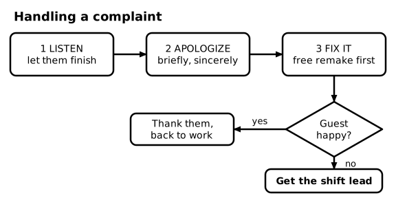
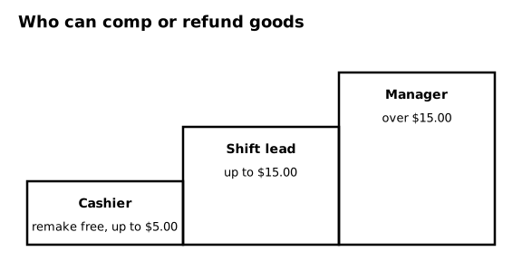
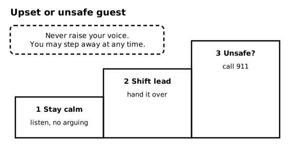
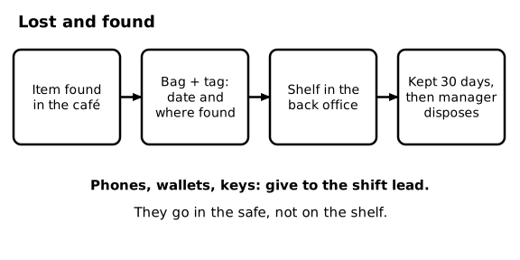

# SOP-250 Guest Service, Complaints, and Difficult Situations

Ember & Oak Coffee is a fictional company. This is a sample document for software testing only.

## 1 Purpose and Scope

### 1.1 Purpose
This SOP explains how to keep guests happy, fix problems quickly, and stay safe when a guest is upset. It applies to everyone on the floor.

## 2 Service Standard

### 2.1 Basics
Greet guests within 10 seconds (see SOP-201). Use the guest's first name when you call a drink. Say thank you to every guest. Answer the café phone within 3 rings by saying, "Ember & Oak, this is" and your first name.

### 2.2 When you do not know
If a guest asks a question you cannot answer, say, "Let me check," and ask the shift lead. Never guess about allergens.

## 3 Handling a Complaint

### 3.1 Listen
<!-- step -->
Let the guest finish speaking without interrupting. Keep your hands visible and your voice calm.

### 3.2 Apologize
<!-- step -->
Apologize briefly and sincerely, for example, "I'm sorry about that." Do not blame a coworker or make excuses.

### 3.3 Fix it
<!-- step -->
Offer a free remake first (see SOP-202). If the guest still wants a refund, follow the refund approval levels in SOP-202.

### 3.4 Check back
<!-- step -->
Ask whether the guest is happy now. If the guest is still unhappy, get the shift lead right away.

### 3.5 Diagram - Handling a complaint

Figure 3.5 shows: Complaint steps: 1 listen, 2 apologize, 3 fix it with a free remake first. If the guest is happy, thank them. If not, get the shift lead.

## 4 Comps

### 4.1 Comp authority
| Who | May comp up to |
|---|---|
| Cashier | $5.00 (a free remake counts here) |
| Shift lead | $15.00 |
| Manager | Over $15.00 |

### 4.2 Rules
Enter the POS comp code and the reason for every comp. Never comp your own order, a friend's order, or a family member's order.

### 4.3 Diagram - Who can comp or refund goods

Figure 4.3 shows: Comp authority: cashier up to $5.00 (a free remake counts), shift lead up to $15.00, manager over $15.00.

## 5 Upset or Unsafe Guests

### 5.1 Stay calm
<!-- step -->
Keep your voice low and slow. Do not argue. You may step away at any time.

### 5.2 Get the shift lead
<!-- step -->
Hand the situation to the shift lead. Stay nearby but let the shift lead talk.

### 5.3 If it is unsafe
<!-- step -->
If a guest threatens anyone or will not leave when asked by the manager, call 911. Do not touch the guest.

### 5.4 Harassment
Nobody has to put up with insults or harassment. A guest who harasses a team member can be asked to leave by the shift lead or the manager.

### 5.5 Diagram - Upset or unsafe guest

Figure 5.5 shows: Upset or unsafe guest: 1 stay calm and listen, 2 get the shift lead, 3 if it is unsafe, call 911. Never raise your voice, and you may step away at any time.

## 6 Lost and Found

### 6.1 Found item
<!-- step -->
Put the item in a bag and write the date and where it was found on the tag.

### 6.2 Where it goes
<!-- step -->
Ordinary items go on the lost and found shelf in the back office. Phones, wallets, and keys go to the shift lead, who puts them in the safe.

### 6.3 How long
Keep items for 30 days. After 30 days the manager disposes of them.

### 6.4 Diagram - Lost and found

Figure 6.4 shows: Lost and found: bag the item and tag it with the date and where it was found, put it on the shelf in the back office, keep it 30 days, then the manager disposes of it. Phones, wallets, and keys go to the shift lead and into the safe.

## 7 Special Situations

### 7.1 Service animals
Only service animals are allowed inside. Do not ask for proof. You may ask only two questions: Is the animal required because of a disability, and what task has it been trained to do?

### 7.2 Large orders
For any order of 10 drinks or more, tell the shift lead before taking payment, and use a drink carrier for every 4 drinks.
