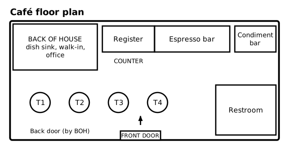
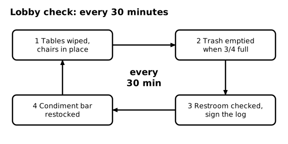
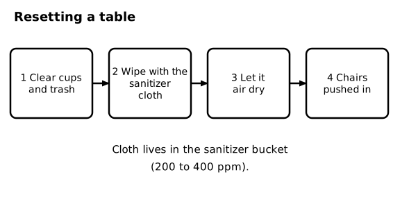
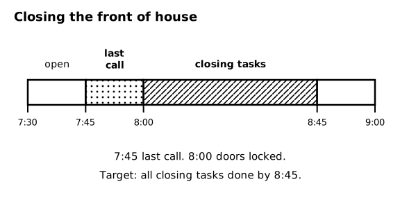

# SOP-260 Front of House - Opening, Lobby Checks, and Closing

Ember & Oak Coffee is a fictional company. This is a sample document for software testing only.

## 1 Purpose and Scope

### 1.1 Purpose
This SOP covers the guest-facing areas: the lobby, tables, restroom, and condiment bar. Back-of-house opening and closing are in SOP-210.

## 2 Layout

### 2.1 Where things are
The counter runs along the back wall with the register on the left and the espresso bar on the right. The condiment bar is at the right end of the counter. Four tables are in the seating area. The restroom is in the front right corner. The front door is at the center of the front wall.

### 2.2 Diagram - Café floor plan

Figure 2.2 shows: Café floor plan: back of house in the back left (dish sink, walk-in, office); counter along the back wall with the register, the espresso bar, and the condiment bar; four tables in the seating area; the restroom at the front right; the front door at the center of the front wall.

## 3 Opening the Front of House

### 3.1 Lights and music
<!-- step -->
Turn on the lobby lights and the music. Music is set to volume level 3.

### 3.2 Walk the lobby
<!-- step -->
Check the floor, tables, and chairs. Wipe every table with the sanitizer cloth.

### 3.3 Stock the condiment bar
<!-- step -->
Fill napkins, stir sticks, sugar, and cream. Put out lids and sleeves.

### 3.4 Check the restroom
<!-- step -->
Check soap, paper towels, and toilet paper. Sign the restroom log.

### 3.5 Open the door
<!-- step -->
Flip the sign to OPEN and unlock the front door at 6:00 AM.

## 4 Lobby Checks

### 4.1 Every 30 minutes
Do a lobby check every 30 minutes. Each check has four parts: tables wiped and chairs in place, trash emptied when it is 3/4 full, restroom checked and the log signed, and condiment bar restocked.

### 4.2 Spills
Wipe up any spill right away and put out the yellow wet-floor sign (see SOP-290).

### 4.3 Diagram - Lobby check: every 30 minutes

Figure 4.3 shows: Lobby check every 30 minutes: 1 tables wiped and chairs in place, 2 trash emptied when 3/4 full, 3 restroom checked and log signed, 4 condiment bar restocked.

## 5 Resetting a Table

### 5.1 Clear
<!-- step -->
Pick up cups, plates, and trash. Put dishes in the dish bin.

### 5.2 Wipe
<!-- step -->
Wipe the table with the cloth from the sanitizer bucket (200 to 400 ppm).

### 5.3 Dry
<!-- step -->
Let the table air dry. Do not wipe it dry with a towel.

### 5.4 Chairs
<!-- step -->
Push the chairs in so the walkway stays clear.

### 5.5 Diagram - Resetting a table

Figure 5.5 shows: Table reset: 1 clear cups and trash, 2 wipe with the cloth from the sanitizer bucket (200 to 400 ppm), 3 let it air dry, 4 push the chairs in.

## 6 Closing the Front of House

### 6.1 Timeline
Last call is 7:45 PM. The front door is locked and the sign is flipped to CLOSED at 8:00 PM. The target for all closing tasks is 8:45 PM.

### 6.2 Lobby closing tasks
<!-- step -->
After the door is locked, wipe all tables, put the chairs on the tables, sweep the lobby, empty the lobby trash, and restock the condiment bar for the morning.

### 6.3 Restroom
<!-- step -->
Do a final restroom check, empty the trash, and sign the restroom log.

### 6.4 Lights
<!-- step -->
Turn off the music and the lobby lights last, after the floors are done.

### 6.5 Diagram - Closing the front of house

Figure 6.5 shows: Front of house closing: last call 7:45 PM, doors locked 8:00 PM, all closing tasks done by 8:45 PM.
