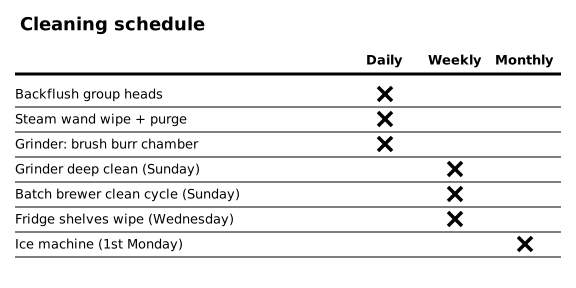
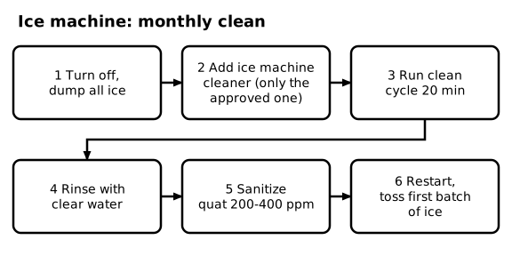
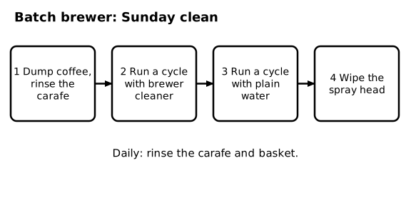
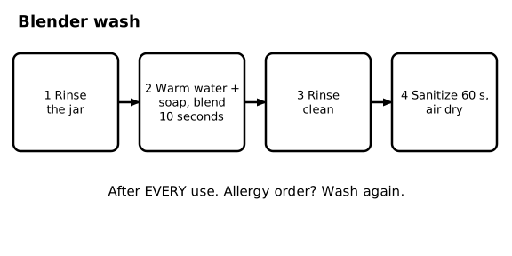
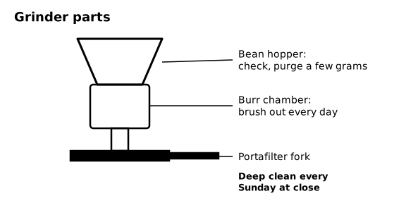

# SOP-270 Equipment Cleaning and Maintenance

Ember & Oak Coffee is a fictional company. This is a sample document for software testing only.

## 1 Purpose and Scope

### 1.1 Purpose
This SOP lists how often each piece of equipment is cleaned and how to clean the ice machine, batch brewer, blender, grinder, and refrigerators. Daily espresso machine cleaning is in SOP-210.

## 2 Cleaning Schedule

### 2.1 Schedule table
| Task | How often |
|---|---|
| Backflush the group heads | Daily |
| Steam wand wipe and purge | Daily, after every use |
| Grinder: brush out the burr chamber | Daily |
| Grinder deep clean | Weekly, Sunday at close |
| Batch brewer clean cycle | Weekly, Sunday |
| Refrigerator shelves wipe | Weekly, Wednesday |
| Ice machine clean | Monthly, first Monday |
| Water filter replaced | Every 6 months |

### 2.2 Log it
Initial the cleaning log every time you finish a task on this list. If a task is missed, tell the shift lead.

### 2.3 Diagram - Cleaning schedule

Figure 2.3 shows: Cleaning schedule: daily is backflush, steam wand, and the grinder burr chamber. Weekly is the Sunday grinder deep clean, the Sunday batch brewer cycle, and the Wednesday fridge shelves. Monthly is the ice machine on the first Monday.

## 3 Ice Machine (Monthly)

### 3.1 Turn off and empty
<!-- step -->
Turn the ice machine off and scoop all the ice into the sink. Throw the ice away.

### 3.2 Add cleaner
<!-- step -->
Pour the approved ice machine cleaner into the water trough, using the amount printed on the cleaner label. Use only the approved cleaner.

### 3.3 Run the cycle
<!-- step -->
Press CLEAN and run the cleaning cycle for 20 minutes.

### 3.4 Rinse
<!-- step -->
When the cycle ends, rinse the inside of the bin and the scoop holder with clear water.

### 3.5 Sanitize
<!-- step -->
Wipe all inside surfaces with quat sanitizer at 200 to 400 ppm and let them air dry.

### 3.6 Restart
<!-- step -->
Turn the machine back on. Throw away the first batch of ice it makes. Sign the cleaning log.

### 3.7 Diagram - Ice machine: monthly clean

Figure 3.7 shows: Ice machine, monthly: 1 turn off and dump all ice, 2 add the approved ice machine cleaner, 3 run the clean cycle for 20 minutes, 4 rinse with clear water, 5 sanitize with quat at 200 to 400 ppm, 6 restart and throw away the first batch of ice.

## 4 Batch Brewer (Sunday)

### 4.1 Daily care
Rinse the carafe and the brew basket every day after the last pot is discarded.

### 4.2 Weekly clean cycle
<!-- step -->
On Sunday, dump any coffee, rinse the carafe, and run one cycle with brewer cleaner and no coffee in the basket.

### 4.3 Rinse cycle
<!-- step -->
Run one more cycle with plain water. Wipe the spray head with a sanitized cloth.

### 4.4 Diagram - Batch brewer: Sunday clean

Figure 4.4 shows: Batch brewer, Sunday: 1 dump the coffee and rinse the carafe, 2 run a cycle with brewer cleaner, 3 run a cycle with plain water, 4 wipe the spray head. Rinse the carafe and basket daily.

## 5 Blender

### 5.1 Wash after every use
<!-- step -->
Rinse the jar right after you pour the drink.

### 5.2 Quick wash
<!-- step -->
Fill the jar halfway with warm water and a drop of soap, lock the lid, and blend for 10 seconds.

### 5.3 Rinse and sanitize
<!-- step -->
Rinse the jar clean, then sanitize it with quat sanitizer at 200 to 400 ppm for 60 seconds and let it air dry.

### 5.4 After an allergy order
Wash the blender again before the next drink if the last drink was an allergy order.

### 5.5 Diagram - Blender wash

Figure 5.5 shows: Blender wash after every use: 1 rinse the jar, 2 warm water and soap and blend for 10 seconds, 3 rinse clean, 4 sanitize for 60 seconds and air dry.

## 6 Grinder

### 6.1 Daily
Brush out the burr chamber every day and wipe the hopper lid. Check the bean hopper and purge a few grams before the first shot (see SOP-210).

### 6.2 Sunday deep clean
At close on Sunday, empty the hopper, remove the burrs, and clean them with the grinder brush. Wipe the portafilter fork and reassemble. Then run a few grams of beans through and discard them.

### 6.3 Diagram - Grinder parts

Figure 6.3 shows: Grinder: check the bean hopper and purge a few grams, brush out the burr chamber every day, and clean the portafilter fork. Deep clean every Sunday at close.

## 7 Refrigerators and Water Filter

### 7.1 Refrigerator shelves
Every Wednesday, take items out, wipe the shelves with sanitizer solution, and put the items back in first in, first out order. Keep the door open as short a time as possible. Each fridge must stay at 41°F or below.

### 7.2 Water filter
The manager replaces the water filter every 6 months and writes the date on the filter and in the maintenance log. If the espresso machine water looks cloudy, tell the shift lead.

## 8 Broken Equipment

### 8.1 Report it
If a machine is broken or leaking, stop using it, hang an OUT OF ORDER tag on it, and tell the shift lead. Never try to repair equipment yourself.
