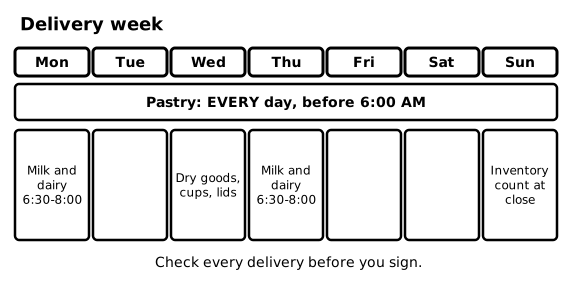
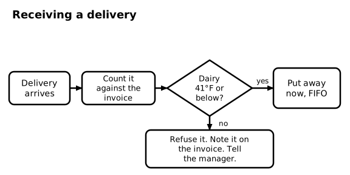
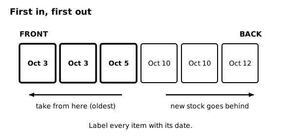
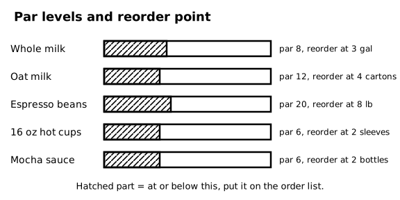
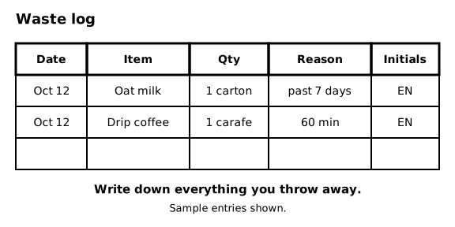

# SOP-280 Deliveries, Inventory, and Ordering

Ember & Oak Coffee is a fictional company. This is a sample document for software testing only.

## 1 Purpose and Scope

### 1.1 Purpose
This SOP explains how to receive deliveries, store stock, count inventory, and record waste.

## 2 Delivery Schedule

### 2.1 Weekly schedule
Pastries arrive every day before 6:00 AM. Milk and dairy arrive on Monday and Thursday between 6:30 AM and 8:00 AM. Dry goods, cups, and lids arrive on Wednesday. The inventory count is done on Sunday at close.

### 2.2 Who receives
The shift lead receives deliveries. A trained team member may help. Never sign for a delivery by yourself on your first week.

### 2.3 Diagram - Delivery week

Figure 2.3 shows: Delivery week: pastries every day before 6:00 AM, milk and dairy Monday and Thursday 6:30 to 8:00 AM, dry goods, cups, and lids on Wednesday, inventory count Sunday at close.

## 3 Receiving a Delivery

### 3.1 Count
<!-- step -->
Count every item against the invoice. Note any shortage on the invoice before the driver leaves.

### 3.2 Check the temperature
<!-- step -->
Probe a milk carton from the delivery. Milk and dairy must be 41°F (5°C) or below. If it is above 41°F, refuse the item.

### 3.3 Check the dates
<!-- step -->
Check every use-by date. Refuse anything that is past its use-by date or within 2 days of it.

### 3.4 Sign and note
<!-- step -->
Sign the invoice only after steps 3.1 to 3.3. Write any refused item on the invoice and tell the manager.

### 3.5 Put it away
<!-- step -->
Put dairy and other cold items away first, within 15 minutes. Then put away dry goods.

### 3.6 Diagram - Receiving a delivery

Figure 3.6 shows: Receiving: count against the invoice, probe the dairy. If it is 41°F or below, put it away right away first in, first out. If not, refuse it, note it on the invoice, and tell the manager.

## 4 First In, First Out

### 4.1 Rule
Put new stock behind old stock. Take from the front. Write the open date on every item you open (see SOP-210).

### 4.2 Diagram - First in, first out

Figure 4.2 shows: First in, first out: take from the front (oldest), and put new stock behind. Label every item with its date.

## 5 Inventory and Par Levels

### 5.1 Weekly count
Count all stock on Sunday at close and write the counts on the inventory sheet.

### 5.2 Par levels
| Item | Par | Reorder at or below |
|---|---|---|
| Whole milk | 8 gallons | 3 gallons |
| Oat milk | 12 cartons | 4 cartons |
| Espresso beans | 20 lb | 8 lb |
| 16 oz hot cups | 6 sleeves | 2 sleeves |
| Mocha sauce | 6 bottles | 2 bottles |

### 5.3 Diagram - Par levels and reorder point

Figure 5.3 shows: Par levels and reorder points: whole milk 8 gallons, reorder at 3. Oat milk 12 cartons, reorder at 4. Espresso beans 20 lb, reorder at 8. 16 oz hot cups 6 sleeves, reorder at 2. Mocha sauce 6 bottles, reorder at 2.

## 6 Ordering

### 6.1 Order list
When an item reaches its reorder level, write it on the order list in the back office. Only the manager places orders.

### 6.2 Running out
If you will run out of something before the next delivery, tell the shift lead right away so the item can be 86'd.

## 7 Waste Log

### 7.1 Write it down
Write every item you throw away on the waste log: date, item, quantity, reason, and your initials. This includes discarded drip coffee, expired milk, and unsold pastries.

### 7.2 Diagram - Waste log

Figure 7.2 shows: Waste log columns: date, item, quantity, reason, initials. Write down everything you throw away.
