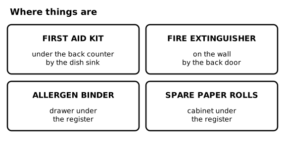
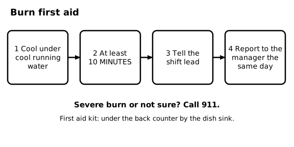
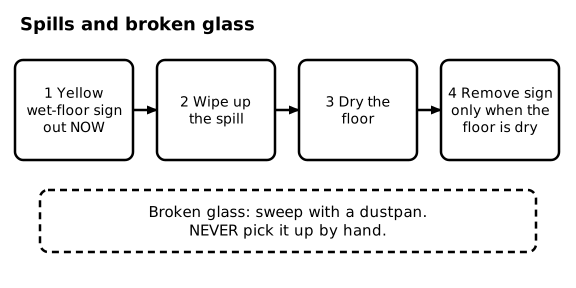
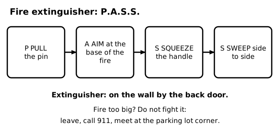
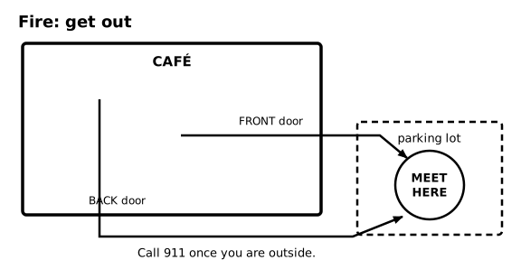
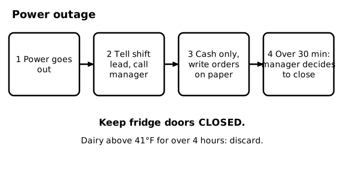

# SOP-290 Safety and Emergencies

Ember & Oak Coffee is a fictional company. This is a sample document for software testing only.

## 1 Purpose and Scope

### 1.1 Purpose
This SOP covers what to do in a burn, cut, spill, fire, power outage, or medical emergency. Robbery is in SOP-202.

## 2 Where Things Are

### 2.1 Locations
The first aid kit is under the back counter by the dish sink. The fire extinguisher is on the wall by the back door. The allergen binder is in the drawer under the register. Spare receipt paper is in the cabinet under the register.

### 2.2 Diagram - Where things are

Figure 2.2 shows: Where things are: first aid kit under the back counter by the dish sink, fire extinguisher on the wall by the back door, allergen binder in the drawer under the register, spare paper rolls in the cabinet under the register.

## 3 Burns

### 3.1 Cool the burn
<!-- step -->
Hold the burn under cool running water for at least 10 minutes.

### 3.2 Tell the shift lead
<!-- step -->
Tell the shift lead right away.

### 3.3 Report it
<!-- step -->
Report every injury to the manager the same day.

### 3.4 When to call 911
If the burn is large, blistering, on the face, or you are not sure, call 911.

### 3.5 Diagram - Burn first aid

Figure 3.5 shows: Burns: 1 cool under cool running water, 2 for at least 10 minutes, 3 tell the shift lead, 4 report to the manager the same day. Large or severe burns: call 911.

## 4 Cuts

### 4.1 Minor cut
<!-- step -->
Wash your hands, apply pressure with clean gauze until the bleeding stops, and cover it with a blue bandage and a glove.

### 4.2 Food contact
If you cut yourself while handling food, stop, throw away any food the blood touched, and tell the shift lead before you go back to work.

## 5 Spills and Broken Glass

### 5.1 Sign first
<!-- step -->
Put out the yellow wet-floor sign right away.

### 5.2 Wipe
<!-- step -->
Wipe up the spill with a clean cloth or mop.

### 5.3 Dry
<!-- step -->
Dry the floor completely.

### 5.4 Remove the sign
<!-- step -->
Take the sign away only when the floor is dry.

### 5.5 Broken glass
Sweep broken glass with a dustpan and brush. Never pick it up by hand. Put it in a box marked GLASS, not the regular trash bag.

### 5.6 Diagram - Spills and broken glass

Figure 5.6 shows: Spills: 1 put out the yellow wet-floor sign, 2 wipe up, 3 dry the floor, 4 remove the sign only when the floor is dry. Broken glass: sweep with a dustpan, never by hand.

## 6 Fire

### 6.1 Small fire
If a fire is no bigger than a small trash can, you may use the extinguisher. Use P.A.S.S.: Pull the pin, Aim at the base of the fire, Squeeze the handle, Sweep side to side.

### 6.2 Big fire
If the fire is bigger, do not fight it. Call 911, leave the building, and meet at the parking lot corner. Do not go back inside.

### 6.3 Headcount
At the meeting point, the shift lead counts the team and guests and tells the fire department if anyone is missing.

### 6.4 Diagram - Fire extinguisher: P.A.S.S.

Figure 6.4 shows: Fire extinguisher P.A.S.S.: Pull the pin, Aim at the base of the fire, Squeeze the handle, Sweep side to side. The extinguisher is on the wall by the back door. If the fire is too big, leave, call 911, and meet at the parking lot corner.

### 6.5 Diagram - Fire: get out

Figure 6.5 shows: Fire evacuation: leave through the front door or the back door and meet at the parking lot corner. Call 911 from outside.

## 7 Power Outage

### 7.1 First steps
<!-- step -->
Tell the shift lead and call the manager.

### 7.2 Keep serving carefully
<!-- step -->
Take cash only. Write each order on a paper ticket.

### 7.3 Protect food
<!-- step -->
Keep the refrigerator and walk-in doors closed. Dairy that has been above 41°F for more than 4 hours must be thrown away.

### 7.4 Long outage
<!-- step -->
If the power is off for more than 30 minutes, the manager decides whether to close.

### 7.5 Diagram - Power outage

Figure 7.5 shows: Power outage: 1 tell the shift lead and call the manager, 2 cash only and write orders on paper, 3 keep fridge doors closed, 4 if over 30 minutes the manager decides whether to close. Dairy above 41°F for over 4 hours is discarded.

## 8 Medical Emergencies

### 8.1 What to do
Call 911 first. Stay with the person and do not move them unless they are in danger. Send someone to the front door to meet the ambulance. Then tell the manager.

## 9 Reporting

### 9.1 Injury report
Every injury, even a small one, is reported to the manager the same day, and an injury report form is filled out.
