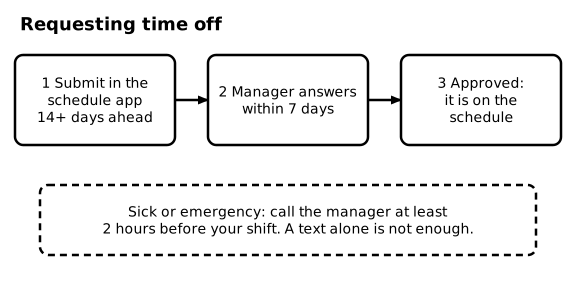
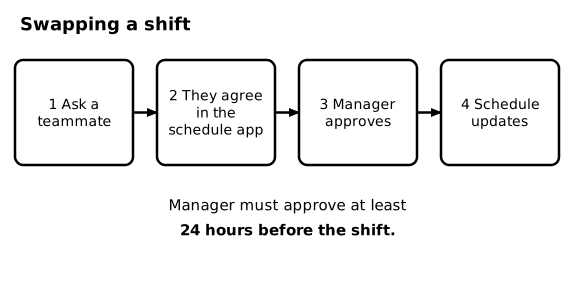
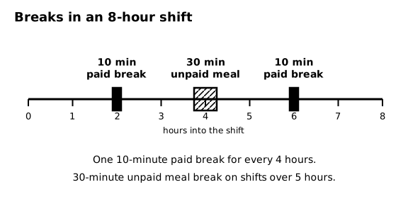
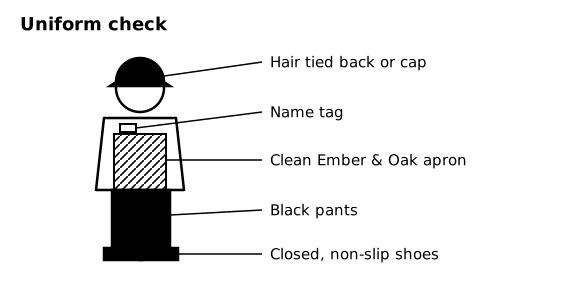
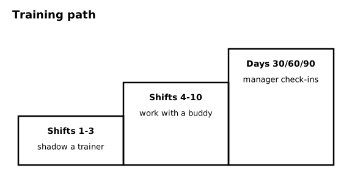

# SOP-300 Team Member Policies - Schedule, Time Off, Breaks, Uniform, Training

Ember & Oak Coffee is a fictional company. This is a sample document for software testing only.

## 1 Purpose and Scope

### 1.1 Purpose
This SOP covers your schedule, time off, shift swaps, breaks, uniform, and training. It applies to every team member.

## 2 The Schedule

### 2.1 When it is posted
The schedule for the next week (Monday to Sunday) is posted in the schedule app every Thursday. Check it every week.

## 3 Arriving and Being Late

### 3.1 Clock in
Clock in no earlier than 5 minutes before your shift. Do not work before you clock in.

### 3.2 If you will be late or sick
Call the manager at least 2 hours before your shift. A text alone is not enough. If you do not call and do not come, that is a no-call, no-show.

## 4 Time Off

### 4.1 Submit the request
<!-- step -->
Submit the request in the schedule app at least 14 days before the first day you want off.

### 4.2 Wait for an answer
<!-- step -->
The manager answers within 7 days.

### 4.3 Check the schedule
<!-- step -->
If the request is approved, it appears on the schedule. Until then, you are still scheduled to work.

### 4.4 Diagram - Requesting time off

Figure 4.4 shows: Time off: submit in the schedule app at least 14 days ahead, the manager answers within 7 days, and approved time off appears on the schedule. Sick or emergency: call the manager at least 2 hours before your shift.

## 5 Shift Swaps

### 5.1 Ask a teammate
<!-- step -->
Ask a teammate who is trained for your position.

### 5.2 Agree in the app
<!-- step -->
Both of you accept the swap in the schedule app.

### 5.3 Manager approval
<!-- step -->
The manager must approve the swap at least 24 hours before the shift. Until the manager approves, you are still responsible for the shift.

### 5.4 Diagram - Swapping a shift

Figure 5.4 shows: Shift swap: 1 ask a teammate, 2 both agree in the schedule app, 3 the manager approves at least 24 hours before the shift, 4 the schedule updates.

## 6 Breaks

### 6.1 Rest breaks
You get one 10-minute paid break for every 4 hours you work. On an 8-hour shift that is two breaks.

### 6.2 Meal break
If your shift is longer than 5 hours, you get a 30-minute unpaid meal break. You may leave the building. Clock out and back in.

### 6.3 Handoff
Tell the shift lead before you go on a break so the register or bar is covered.

### 6.4 Diagram - Breaks in an 8-hour shift

Figure 6.4 shows: Breaks on an 8-hour shift: two 10-minute paid breaks and one 30-minute unpaid meal break. One 10-minute paid break for every 4 hours; a 30-minute unpaid meal break if the shift is over 5 hours.

## 7 Uniform and Phones

### 7.1 Uniform
Wear a clean Ember & Oak apron, black pants, and closed, non-slip shoes. Wear your name tag. Tie back long hair or wear a cap.

### 7.2 Phones
Keep your phone in your pocket or in your locker during your shift. Wash your hands after you touch it (see SOP-210).

### 7.3 Diagram - Uniform check

Figure 7.3 shows: Uniform check: hair tied back or a cap, name tag, a clean Ember & Oak apron, black pants, and closed, non-slip shoes.

## 8 Training

### 8.1 Path
Your first 3 shifts are shadow shifts with a trainer. Shifts 4 to 10 are with a buddy. The manager checks in with you at 30, 60, and 90 days.

### 8.2 Sign-off
A trainer signs off each station (register, bar, back of house) when you can do it on your own.

### 8.3 Diagram - Training path

Figure 8.3 shows: Training path: shifts 1 to 3 shadow a trainer, shifts 4 to 10 work with a buddy, and the manager checks in at days 30, 60, and 90.
